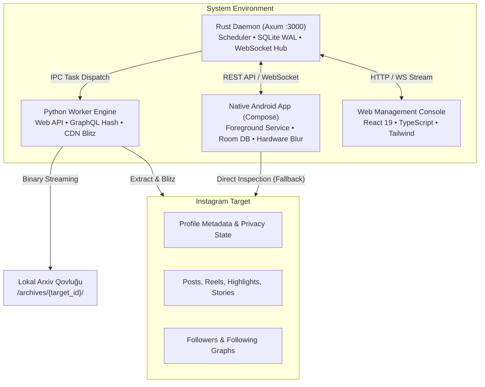
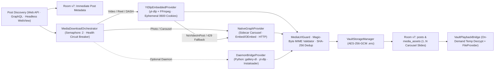

# InstaLogger

InstaLogger is an automated, continuous Instagram profile monitoring and digital archival system. It operates as an asynchronous background daemon, tracking account state transitions, calculating cryptographic media digests, and archiving media before account state or post visibility changes.

[](LICENSE)
[](#)
[](#)
[](#)
[](#)

---

## Overview

Public and private accounts frequently modify metadata, delete publications, or toggle privacy states. InstaLogger provides automated observation with local-first persistence:

- **Two-Phase Asset Blitz:** When a monitored private account becomes public, signed CDN media URLs and metadata are cataloged within seconds, followed by prioritized asynchronous binary streaming to disk.
- **Dual-Layer Hash Verification:** Differentiates genuine profile picture updates from ephemeral CDN token rotations by comparing cryptographic SHA-256 byte digests alongside GraphQL query hashes.
- **Differential Audit Trail:** Chronologically captures changes in usernames, display names, biographies, follower/following counts, and individual follow list differentials (`followers.json`, `following.json`).
- **Non-Destructive Preservation:** Posts deleted or archived on Instagram remain preserved locally with metadata preserved in sidecar format.
- **Cross-Platform Daemon:** Runs natively as a lightweight system service on Android (Termux or Native App), Linux servers, macOS, and Windows.

---

## Architecture



---

## Post Archiving Subsystem

InstaLogger separates post discovery, media extraction, integrity validation, and encrypted local storage into a pluggable multi-provider pipeline. Because `yt-dlp` is dedicated to video, Reels, and DASH stream muxing (and does not extract image-only publications), the orchestrator routes each publication to the appropriate provider with automatic circuit-breaker failover:



Detailed sequence flows, provider routing tables, circuit-breaker state machines, Room `v7` entity schemas, and security controls are documented in [docs/MEDIA_ARCHIVING_ARCHITECTURE.md](docs/MEDIA_ARCHIVING_ARCHITECTURE.md).

---

## Installation & Deployment

### Android (Termux)

Root access is not required.

```bash
pkg update && pkg install -y git rust python nodejs-lts termux-api
pip install requests instaloader urllib3

git clone https://github.com/ramilseferov/instalogger.git
cd instalogger
cargo build --release
```

### Linux (Ubuntu / Debian / Arch / Fedora)

```bash
git clone https://github.com/ramilseferov/instalogger.git
cd instalogger
pip install requests instaloader urllib3
cargo build --release
```

### Windows (PowerShell)

```powershell
git clone https://github.com/ramilseferov/instalogger.git
cd instalogger
pip install requests instaloader urllib3
cargo build --release
```

---

## CLI Reference

Control the daemon and background scheduler through the host script:

| Bash Command | PowerShell Command | Purpose |
| :--- | :--- | :--- |
| `instalogger start` | `.\instalogger.ps1 start` | Starts daemon in background with wake-lock |
| `instalogger status` | `.\instalogger.ps1 status` | Queries process health, uptime, and target metrics |
| `instalogger logs` | `.\instalogger.ps1 logs` | Tails live scheduler and engine stdout |
| `instalogger stop` | `.\instalogger.ps1 stop` | Signals graceful termination to daemon and workers |
| `instalogger restart` | `.\instalogger.ps1 restart` | Restarts the running service and refreshes scheduler |

The local web dashboard binds to `http://127.0.0.1:3000`.

---

## File and Archive Layout

```
instalogger/
├── data/
│   └── instalogger.db               # SQLite database (WAL journal mode)
├── sessions/
│   └── instagram_session.json      # Optional authenticated session tokens
├── logs/
│   └── instalogger.log              # Persistent execution and inspection logs
└── archives/
    └── <target_username_or_id>/
        ├── followers.json           # Cached follower accounts with diff metadata
        ├── following.json           # Cached following accounts with diff metadata
        ├── profile/                 # Historical avatars and metadata snapshots
        │   ├── avatar_current.jpg
        │   └── <timestamp>_<hash>.jpg
        ├── posts/                   # Static photo publications with sidecar metadata
        ├── reels/                   # MP4 video streams
        └── highlights/              # Organized highlight collections
```

---

## Native Android Application

The `android/` directory contains an independent native Android application developed with Jetpack Compose:

- **Native Android Application:** Kotlin, Jetpack Compose, Material 3, Room SQLite (`v7`), Coroutines & Flow.
- **Pluggable Multi-Provider Media Archiver:** Combines embedded `yt-dlp` + `FFmpeg` (Reels, Videos, DASH muxing, runtime `STABLE`/`NIGHTLY` self-updates), `NativeGraphProvider` (HD Photos, multi-slide Carousels via `edge_sidecar_to_children` and Embed/OEmbed), `HeadlessInstagramScraper` (zero-login public discovery), and optional `DaemonBridgeProvider` (`gallery-dl` CLI subprocess, `yt-dlp`, `Instaloader`).
- **Cryptographic Integrity & Vault Storage:** Enforces CDN host allowlisting, binary magic-byte verification (rejecting HTML login redirects), SHA-256 content-addressed deduplication, ephemeral `0600` zero-wiped cookie files, AES-256-GCM encrypted Vault storage, and on-demand `FileProvider` decryption for video playback and export.
- **Circuit-Breaker Fault Tolerance:** Persists per-provider health metrics (`provider_health`) with exponential cooldowns on `HTTP 429` rate limits and automatic fallback across healthy providers.
- **Foreground Monitoring:** Background service (`InstaLoggerForegroundService`) executes scheduled profile checks with battery optimization exclusion (`ACTION_IGNORE_BATTERY_OPTIMIZATION_SETTINGS`).
- **Follower Growth & Audit:** Real-time tracking of follower gained/lost and following changes with Bezier growth charts and diff audits.
- **Multilingual Support:** Localized string catalogs for Azerbaijani (`AZ`), English (`EN`), and Russian (`RU`).

For full technical specifications, sequence diagrams, circuit-breaker state machines, and Room `v7` entity schemas of the post archiving pipeline, see [Media Archiving Architecture](docs/MEDIA_ARCHIVING_ARCHITECTURE.md).

---

## License

Distributed under the [MIT License](LICENSE). Maintained by [Ramil Seferov](https://github.com/ramilseferov).
