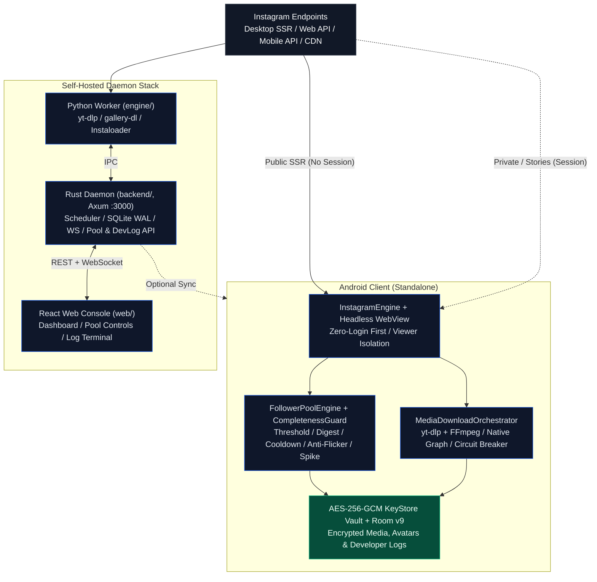

<p align="center">
  
</p>

<p align="center">
  <strong>Local-first Instagram profile monitoring, change auditing, and encrypted media archival across Android, Linux, macOS, and Windows.</strong>
</p>

<p align="center">
  <a href="LICENSE"></a>
  <a href="#android-application"></a>
  <a href="#rust-daemon--web-console"></a>
  <a href="#python-extraction-engine"></a>
</p>

---

## Why InstaLogger Exists

Instagram accounts change display names, biographies, avatars, privacy states, and post visibility without leaving a public history. InstaLogger tracks those transitions locally, preserves media before it is deleted or hidden behind a private lock, and stores archives under your own control without third-party cloud relays.

The repository ships two independent deployment modes that share a common storage and protocol model:

1. **Standalone Android Application (`android/`)** — Native Kotlin + Jetpack Compose client with a foreground monitoring service, Room SQLite (`v9`), embedded `yt-dlp` + FFmpeg, on-device headless Chromium fallback, and Android KeyStore AES-256-GCM vault encryption.
2. **Self-Hosted Daemon Stack (`backend/`, `engine/`, `web/`)** — Rust Axum HTTP/WebSocket daemon, Python media extraction workers, and a React + TypeScript management console served on `http://127.0.0.1:3000`.

---

## System Architecture



---

## Subsystem Capabilities

| Capability | Android (`android/`) | Daemon + Web (`backend/` + `web/`) | Python Engine (`engine/`) |
| :--- | :--- | :--- | :--- |
| Zero-login public profile & post scraping | Desktop SSR + Guest API | Worker IPC + REST | Desktop SSR + GraphQL |
| Active 24h story indicator (`latest_reel_media`) | Ring + Badge + Alert | Badge + Story Viewer | Supported |
| Story & highlight media extraction | Mobile API + WebView Hook | Archive viewer | `gallery-dl` / `instaloader` |
| Multi-provider post & carousel archiver | `yt-dlp` + FFmpeg + Native | Orchestrator bridge | `yt-dlp` / `gallery-dl` / `instaloader` |
| Follower Change Pool (`OFF / FIXED / % / AUTO`) | Global + Per-Target + Flush | Global + Per-Target + Flush | — |
| Digest, Cooldown, Anti-Flicker, Spike Guard | Full user control | Configurable via API/UI | — |
| Partial-list Completeness Guard (`50`-item cap) | Enabled (toggleable) | Configurable via API/UI | — |
| Hardware-backed encrypted media & avatar vault | AES-256-GCM KeyStore | Local filesystem archive | SHA-256 deduplicated |
| Redacted terminal Developer Logs | Encrypted in-app console | `/api/dev-logs` terminal UI | Structured stderr/log |
| Languages | AZ, EN, RU | AZ, EN, RU | — |

---

## Core Engineering Decisions

### Zero-Login-First & Viewer Identity Isolation
Public profile metadata, post grids, carousel slides, and highlight trays are fetched anonymously via Desktop SSR first. Session cookies are never attached to anonymous HTML profile scraping, eliminating viewer JSON leakage (`PolarisViewer`) into tracked accounts. All JSON responses verify that `user.username` matches the requested target before persisting, and prefer numeric REST `pk` over 17-digit GraphQL node IDs.

### Follower Change Pool for High-Velocity Accounts
Large accounts can fluctuate by multiple followers per second. InstaLogger keeps classic instant notifications (`OFF`) as the default while giving full global and per-profile control over:
- **Pooling modes:** `OFF` (instant), `FIXED_COUNT` (e.g. `±50`), `PERCENTAGE` (e.g. `0.5%`), and `AUTO_ADAPTIVE` (tiered by follower count from `1` to `5,000`).
- **Noise controls:** Time-window Digest summaries, alert Cooldowns, single-poll CDN Anti-Flicker hysteresis, and Spike breakthrough alerts for abnormal jumps.
- **Completeness Guard:** Distinguishes `COMPLETE`, `PARTIAL`, and `EMPTY_UNEXPECTED` follower list fetches so truncated 50-user API slices never generate false unfollow alerts.

### Encrypted Vault & Redacted Developer Logs
- Media files, avatars, highlight covers, and developer logs on Android are encrypted at rest with hardware-backed Android KeyStore AES-256-GCM (KeyStore-generated random 12-byte IVs) and decrypted on demand in RAM by Coil (`VaultMediaFetcher`) or ephemeral `FileProvider` streams (`VaultPlaybackBridge`).
- Every HTTP request status, tier fallback, download result, and error is logged to a monospace terminal console (`Developer Logs`) with automatic redaction of `sessionid`, `csrftoken`, `ds_user_id`, and signed CDN parameters (`oh`, `oe`).

---

## Building & Testing

### Android Application
Requires JDK 17 and Android SDK (`compileSdk 35`, `arm64-v8a`).

```bash
cd android
./gradlew assembleDebug
./gradlew testDebugUnitTest
```

### Rust Daemon (`backend/`)
Requires Rust 1.78+ and SQLite3.

```bash
cd backend
cargo test
cargo build --release
```

### Web Management Console (`web/`)
Requires Node.js 20+.

```bash
cd web
npm install
npm run build
```

When the Rust daemon runs, it serves the compiled `web/dist` bundle and REST/WebSocket API at `http://127.0.0.1:3000`.

The daemon requires a dashboard PIN before it starts. An existing configured PIN is reused. On first start, set `INSTALOGGER_PIN_FILE` to the absolute path of a private file containing your chosen 4–12 digit PIN. Keep it outside the repository and archive directories and readable only by the service account. After successful initialization the file is no longer needed. Change the PIN from the authenticated dashboard. Changing it signs out existing sessions.

For remote browser access, terminate HTTPS at a reverse proxy, preserve the original Host header and forward WebSocket upgrades. The browser uses a Secure, HttpOnly session cookie for the API, archives and WebSocket. Plain HTTP is intended only for localhost. Rebuild both the daemon and web bundle before restarting an existing deployment.


### Python Extraction Engine (`engine/`)
Requires Python 3.11+.

```bash
pip install -r engine/requirements.txt
python3 -m unittest discover -s engine/tests -v
```

### Service Script (`instalogger` / `instalogger.ps1`)

| Action | Bash (Linux / Termux) | PowerShell (Windows) |
| :--- | :--- | :--- |
| Start daemon | `./instalogger start` | `.\instalogger.ps1 start` |
| Status & health | `./instalogger status` | `.\instalogger.ps1 status` |
| Tail logs | `./instalogger logs` | `.\instalogger.ps1 logs` |
| Stop daemon | `./instalogger stop` | `.\instalogger.ps1 stop` |

---

## Repository Layout

```text
instalogger/
├── android/                  # Native Kotlin + Jetpack Compose app (Room v9, Vault, yt-dlp)
├── backend/                  # Rust Axum daemon (SQLite WAL, scheduler, REST/WS, dev-logs API)
├── engine/                   # Python workers & pluggable media providers (yt-dlp, gallery-dl, instaloader)
├── web/                      # React 19 + TypeScript + Tailwind console (light/dark, pool UI, log terminal)
├── docs/
│   ├── MEDIA_ARCHIVING_ARCHITECTURE.md
│   └── superpowers/specs/2026-11-24-follower-change-pool-design.md
├── build.sh                  # Remote build & Shizuku APK deployment script
├── instalogger               # POSIX daemon control wrapper
└── instalogger.ps1           # Windows daemon control wrapper
```

---

## Technical Documentation

- [Media Archiving Architecture](docs/MEDIA_ARCHIVING_ARCHITECTURE.md) — Multi-provider routing, circuit-breaker state machine, security guards, and storage schema.
- [Follower Change Pool Specification](docs/superpowers/specs/2026-11-24-follower-change-pool-design.md) — Pool modes, anti-flicker hysteresis, spike detection, and completeness guard rules.

---

## License

MIT License. See [LICENSE](LICENSE) for details.
