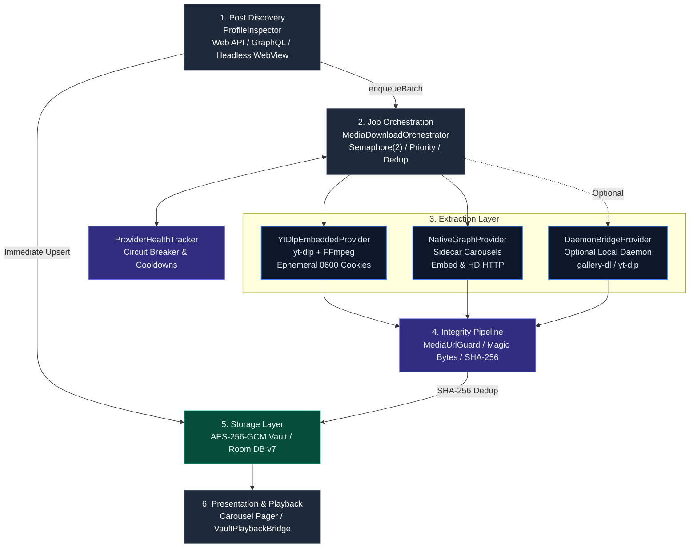
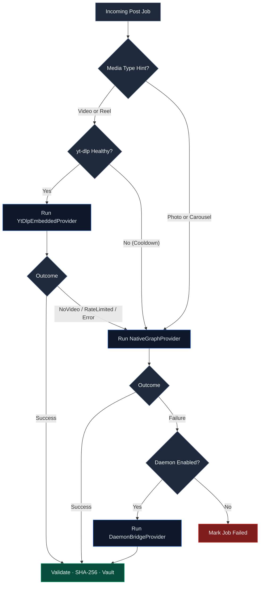
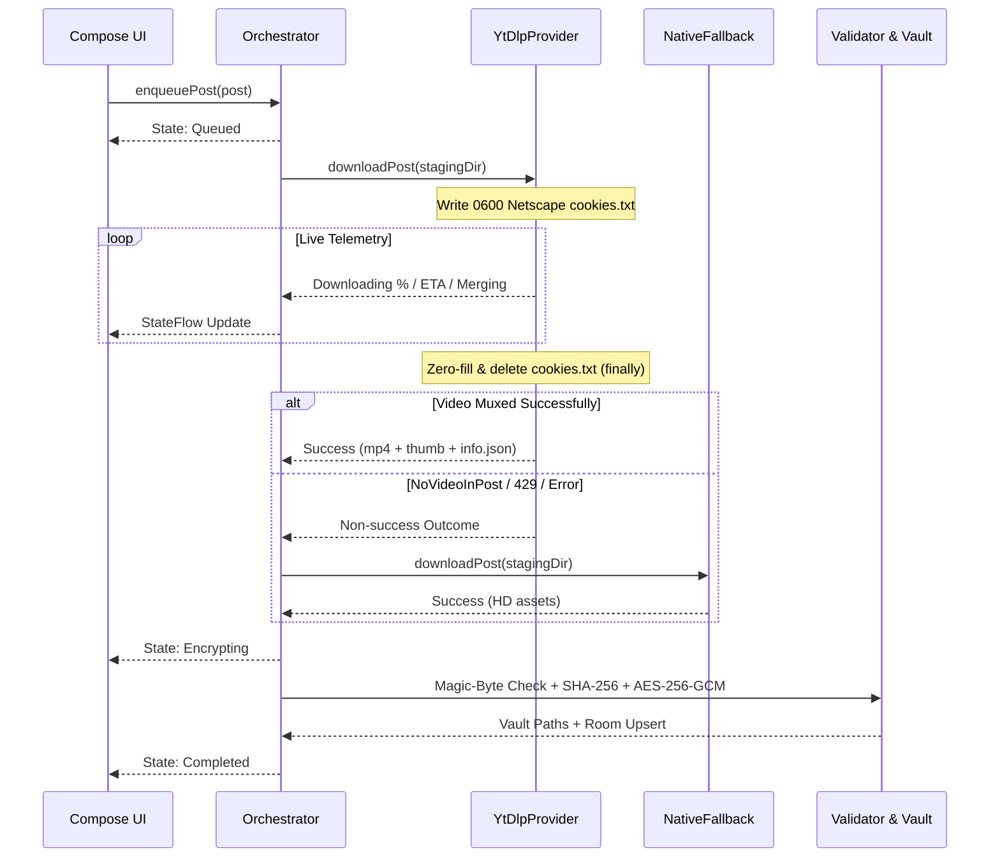
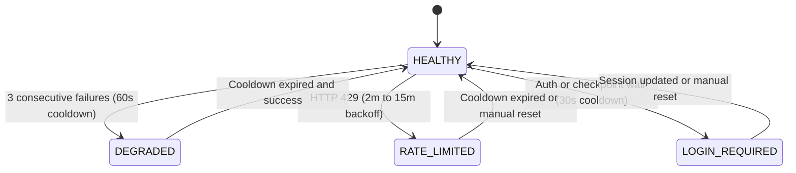
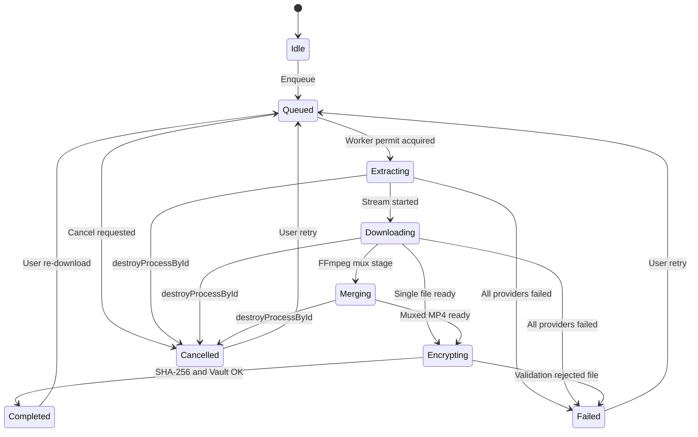
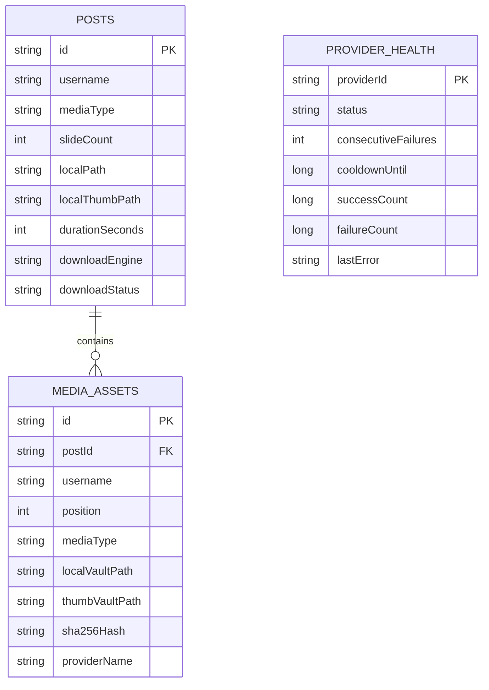

# Post Archiving & Multi-Provider Media Architecture

Technical specification of InstaLogger's post discovery, pluggable extraction pipeline, binary integrity verification, encrypted Vault storage, and fault-tolerance model across the native Android application (`android/`) and optional Python daemon (`engine/providers/`).

---

## 1. Design Rationale

Single-tool Instagram archiving fails under production conditions for three structural reasons:

1. `yt-dlp` is dedicated to video, Reels, and DASH audio/video muxing via FFmpeg; it explicitly rejects photo-only publications and image carousels (`There is no video in this post`).
2. Direct GraphQL/Embed HTTP extraction resolves static photos and multi-slide carousels (`edge_sidecar_to_children`, `carousel_media`) rapidly, but cannot mux split DASH media streams.
3. Any individual extractor can hit `HTTP 429 Too Many Requests`, authentication walls, or schema changes.

InstaLogger isolates **discovery**, **extraction**, **verification**, and **encrypted persistence** behind a pluggable `InstagramMediaProvider` interface orchestrated by `MediaDownloadOrchestrator` and protected by `ProviderHealthTracker`.

---

## 2. End-to-End Archiving Pipeline

---

## 3. Provider Routing & Failover Logic

### Capability Matrix

| Content Type | Primary (Android) | Automatic Fallback (Android) | Primary (Python Daemon) | Fallback (Python Daemon) |
| :--- | :--- | :--- | :--- | :--- |
| Reel / Video Post | `yt-dlp` (Embedded + FFmpeg) | `native-graph`, then `daemon-bridge` | `yt-dlp` | `gallery-dl`, then `instaloader-http` |
| Static Photo Post | `native-graph` | `daemon-bridge` (or `yt-dlp` on manual retry) | `gallery-dl` | `instaloader-http` |
| Multi-Slide Carousel | `native-graph` | `yt-dlp`, then `daemon-bridge` | `gallery-dl` | `yt-dlp`, then `instaloader-http` |
| Public Discovery | `InstagramEngine` + `HeadlessInstagramScraper` | Embed / OEmbed API | `InstagramClient` | `Instaloader` |

---

## 4. Video / Reel Execution Sequence

---

## 5. Circuit Breaker & Job Lifecycles

### Provider Health State Machine (`ProviderHealthTracker`)

### Per-Post Download Job Lifecycle (`PostDownloadState`)

### Error Classification (`YtDlpEmbeddedProvider`)

| Stderr / Runtime Pattern | Outcome Type | Orchestrator Action |
| :--- | :--- | :--- |
| `There is no video in this post`, `no video formats found` | `UnsupportedMedia` | Fall back to `NativeGraphProvider` without health penalty |
| `429`, `Too Many Requests`, `rate-limit` | `RateLimited` | Apply exponential cooldown (2m, 4m, 10m, 15m cap) and fail over |
| `login required`, `checkpoint`, `empty media response` | `LoginRequired` | Apply 30s auth cooldown and fail over |
| Process terminated / Coroutine cancelled | `Cancelled` | Halt execution, purge staging directory and cookie file |
| I/O or network failure | `Failure` | Increment failure counter (`>= 3` triggers 60s degraded cooldown) |

---

## 6. Persistence Schema (`Room Database v7`)

Lossless `MIGRATION_6_7` preserves all existing targets, change logs, and archived publications.

---

## 7. Security, Privacy & Integrity Pipeline

1. **Ephemeral Cookie Isolation (`NetscapeCookieBridge`):**
   - Session cookies stay encrypted at rest in `SessionManager` (Android KeyStore AES-256-GCM).
   - Before invoking `yt-dlp`, a temporary Netscape cookie file is written to `noBackupFilesDir/ytdlp_cookies/` with `0600` owner-only permissions.
   - A `finally` block overwrites the file with zero bytes, calls `fd.sync()`, and deletes it. Orphaned files from abrupt process kills are purged on startup.
2. **Log Redaction (`LogSanitizer`):**
   - Redacts `sessionid`, `csrftoken`, `ds_user_id`, `rur`, `mid`, `ig_did`, `Authorization`, `Cookie`, and signed CDN query parameters (`oh`, `oe`, `_nc_sid`, `signature`, `token`) before logging or saving `provider_health.lastError`.
3. **Host Allowlist (`MediaUrlGuard`):**
   - Enforces HTTPS and restricts external downloads to verified Meta/Instagram domains (`instagram.com`, `cdninstagram.com`, `fbcdn.net`, `fbsbx.com`). Local HTTP is allowed solely for `DaemonBridgeProvider`.
4. **Magic-Byte Verification (`MediaFileValidator`):**
   - Enforces size limits (`128 B` to `250 MB`), inspects binary headers (`JPEG`, `PNG`, `GIF`, `WEBP`, `MP4 ftyp`, `WebM/MKV`), and rejects HTML/XML/JSON login walls returned with `HTTP 200`.
5. **SHA-256 Deduplication & AES-256-GCM Vault:**
   - Computes streaming SHA-256 digests prior to encryption. Matching digests for the same target reuse the existing Vault `.enc` path instead of writing duplicate ciphertext.
6. **Decrypted Playback & Export (`VaultPlaybackBridge`):**
   - Decrypts Vault `.enc` media on demand into `cacheDir/playback_tmp/`, exposes a scoped `FileProvider` URI (`${applicationId}.fileprovider`), and prunes temporary files older than 30 minutes.

---

## 8. Packaging, Runtime Updates & License Isolation

- **Native Dependencies (`android/app/build.gradle.kts`):** `io.github.junkfood02.youtubedl-android:library:0.18.1` and `ffmpeg:0.18.1`, scoped to `arm64-v8a` with `packaging.jniLibs.useLegacyPackaging = true`.
- **Self-Updating Runtime:** `YtDlpEmbeddedProvider.updateBinary(channel)` updates the embedded `yt-dlp` runtime from `STABLE` or `NIGHTLY` inside `SettingsScreen` without rebuilding the APK.
- **License Isolation:** The Android APK embeds only permissive components. In the optional Python daemon (`engine/providers/gallerydl_provider.py`), `gallery-dl` (GPL-2.0) runs strictly as an isolated external CLI subprocess and is never statically linked into the Android app.

---

## 9. Component Reference

| Component | Path | Responsibility |
| :--- | :--- | :--- |
| Provider Contracts | `android/.../engine/media/MediaProvider.kt` | Interfaces, capabilities, quality presets, state and outcome models |
| Security & Hashing | `android/.../engine/media/SecurityIntegrity.kt` | `LogSanitizer`, `MediaUrlGuard`, `MediaFileValidator` (magic bytes, SHA-256) |
| Cookie Bridge | `android/.../engine/media/NetscapeCookieBridge.kt` | Ephemeral `0600` Netscape cookie file generation and zero-fill wipe |
| Video/Reel Engine | `android/.../engine/media/YtDlpEmbeddedProvider.kt` | Embedded `yt-dlp` + FFmpeg execution, progress telemetry, cancellation, self-update |
| Photo/Carousel Engine | `android/.../engine/media/NativeGraphProvider.kt` | Sidecar carousel extraction, Embed/OEmbed enrichment, HD HTTP fallback |
| Daemon Bridge | `android/.../engine/media/DaemonBridgeProvider.kt` | Optional HTTP bridge to the local/remote Python daemon |
| Circuit Breaker | `android/.../engine/media/ProviderHealthTracker.kt` | Persistent provider cooldown and failure state tracking |
| Orchestrator | `android/.../engine/media/MediaDownloadOrchestrator.kt` | Bounded concurrency (`Semaphore(2)`), routing, SHA-256 dedup, atomic Vault writes |
| Playback Bridge | `android/.../util/VaultPlaybackBridge.kt` | On-demand Vault decryption and `FileProvider` URI provisioning |
| Python Daemon Stack | `engine/providers/*.py` | `InstagramProvider` protocol, `yt-dlp`, GPL-isolated `gallery-dl`, `instaloader-http`, orchestrator |
