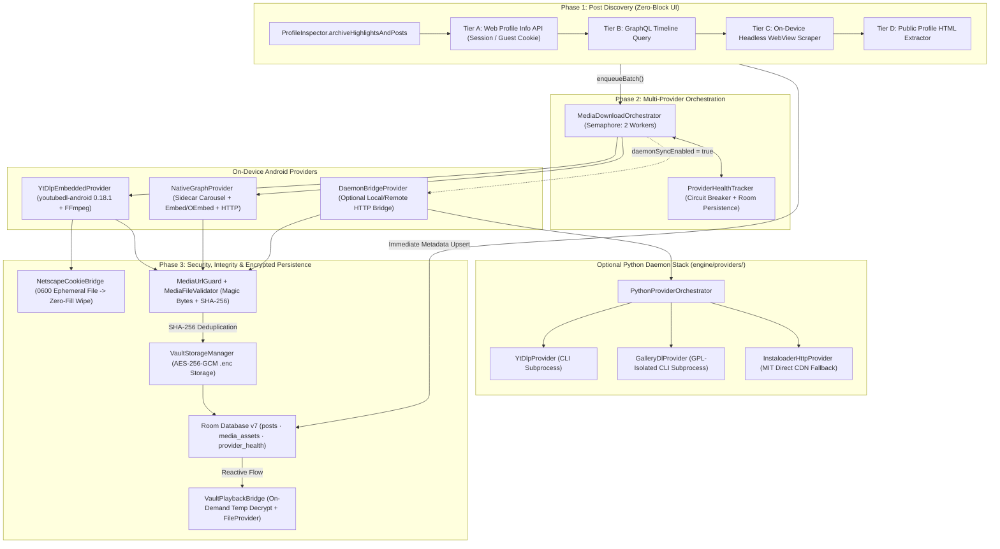
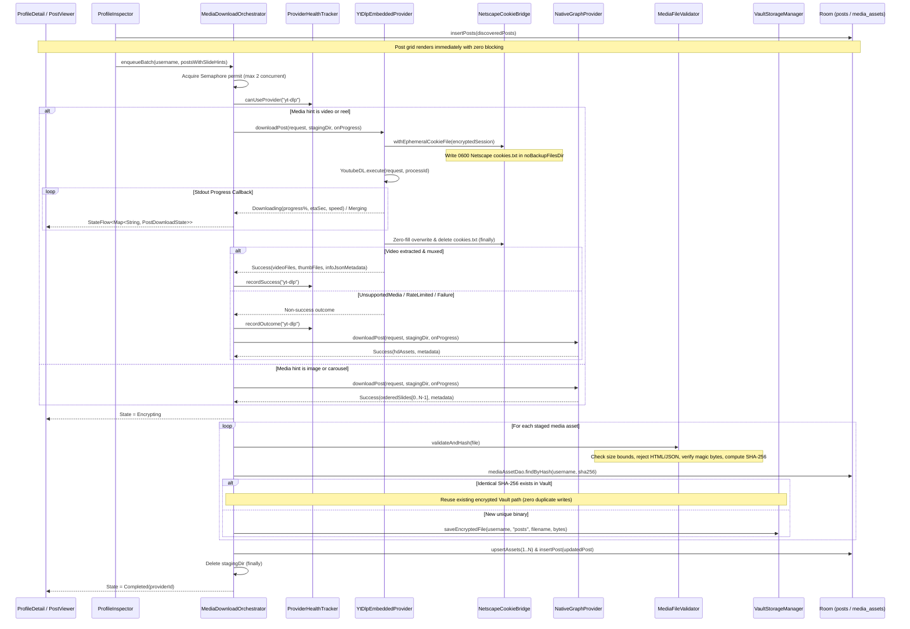
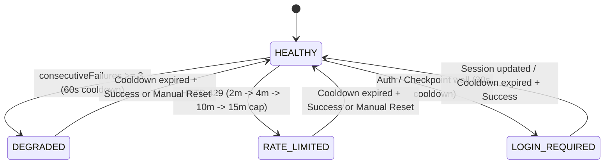
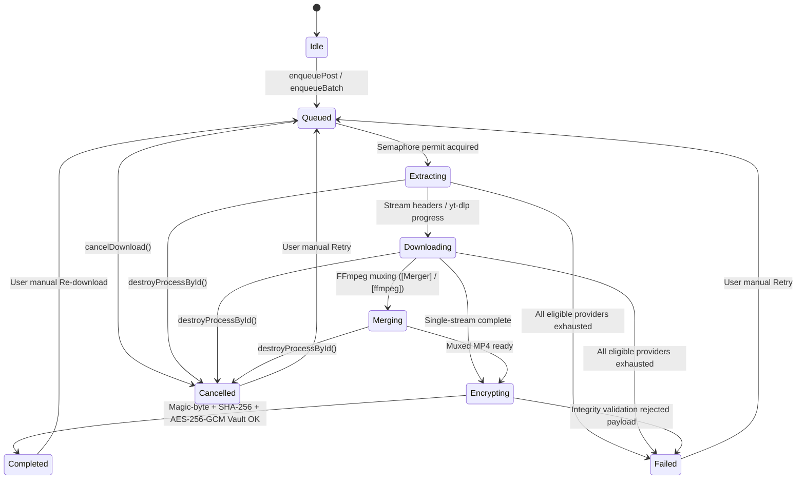
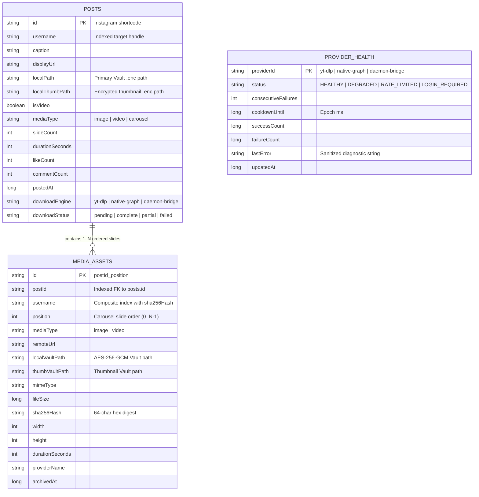

# Post Archiving & Multi-Provider Media Engine Architecture

This document specifies the design, execution flow, persistence schema, security controls, and fault-tolerance model of InstaLogger's post discovery and media archival subsystem across both the standalone Android application (`android/`) and the optional Python daemon engine (`engine/providers/`).

---

## 1. Design Rationale

Archiving Instagram publications reliably cannot depend on a single extraction tool:

- `yt-dlp` is specialized for video, Reels, and DASH audio/video muxing via FFmpeg, but explicitly refuses image-only publications and photo-only carousels (`There is no video in this post`).
- Direct HTTP/GraphQL endpoints handle single images, multi-slide carousels (`edge_sidecar_to_children` / `carousel_media`), and metadata rapidly, but fail on split DASH media streams and are vulnerable to dynamic CDN signature expiration.
- Any individual extractor may encounter transient `HTTP 429 Too Many Requests`, authentication walls, or schema changes.

To eliminate single-provider fragility, InstaLogger decouples **post discovery**, **media extraction**, **integrity verification**, and **encrypted persistence** behind a pluggable `InstagramMediaProvider` interface managed by a bounded, health-aware orchestrator.

---

## 2. High-Level Subsystem Topology

---

## 3. Provider Capabilities and Routing Matrix

Each provider declares its capabilities through `ProviderCapability` (`PHOTO_POST`, `VIDEO_POST`, `REEL`, `CAROUSEL`, `METADATA`, `SELF_UPDATABLE`) and returns structured `ProviderOutcome` results (`Success`, `UnsupportedMedia`, `RateLimited`, `LoginRequired`, `Cancelled`, `Failure`).

| Content Type | Primary Provider (Android) | Automatic Fallback (Android) | Primary Provider (Python Daemon) | Fallback Chain (Python Daemon) |
| :--- | :--- | :--- | :--- | :--- |
| Reel / Video Post | `yt-dlp` (Embedded + FFmpeg) | `native-graph` -> `daemon-bridge` | `yt-dlp` | `gallery-dl` -> `instaloader-http` |
| Static Photo Post | `native-graph` | `daemon-bridge` (or `yt-dlp` on manual retry) | `gallery-dl` | `instaloader-http` |
| Multi-Slide Carousel | `native-graph` (or `yt-dlp` on user retry) | `yt-dlp` / `native-graph` -> `daemon-bridge` | `gallery-dl` | `yt-dlp` -> `instaloader-http` |
| Zero-Login Public Listing | `HeadlessInstagramScraper` + `InstagramEngine` | Embed / OEmbed API | `InstagramClient` | `Instaloader` |

### Error Classification Rules (`YtDlpEmbeddedProvider`)

| Stderr / Runtime Pattern | Classified `ProviderOutcome` | Orchestrator Action |
| :--- | :--- | :--- |
| `There is no video in this post`, `no video formats found` | `UnsupportedMedia` | Advance immediately to `NativeGraphProvider` without penalizing health |
| `429`, `Too Many Requests`, `rate-limit` | `RateLimited` | Trigger circuit-breaker cooldown (`120s * multiplier`, capped at `15m`) and advance |
| `login required`, `checkpoint`, `empty media response` | `LoginRequired` | Mark `LOGIN_REQUIRED` (`30s` cooldown) and advance |
| Process destroyed / coroutine cancelled | `Cancelled` | Halt job cleanly, wipe staging directory and cookie file |
| Network / I/O / parsing error | `Failure` | Increment consecutive failures (`>= 3` triggers `60s` degraded cooldown) and advance |

---

## 4. End-to-End Execution Sequence

---

## 5. Circuit Breaker and Job State Machines

### Provider Health Lifecycle (`ProviderHealthTracker`)

### Per-Post Download Job Lifecycle (`PostDownloadState`)

---

## 6. Persistence Schema (`Room Database v7`)

Lossless `MIGRATION_6_7` upgrades existing installations without discarding targets or previously archived posts.

---

## 7. Security, Privacy, and Integrity Controls

1. **Ephemeral Cookie Isolation (`NetscapeCookieBridge`):**
   - Session cookies remain encrypted at rest inside `SessionManager` (Android KeyStore AES-256-GCM).
   - For `yt-dlp` execution, a temporary Netscape HTTP Cookie File is created inside `context.noBackupFilesDir/ytdlp_cookies/` with owner-only read/write permissions (`0600`).
   - A mandatory `finally` block overwrites the file with zero bytes, invokes `fd.sync()`, and unlinks it. Any orphaned files from hard process kills are purged on application startup (`warmUpAsync()`).
2. **Log Sanitization (`LogSanitizer`):**
   - Strips `sessionid`, `csrftoken`, `ds_user_id`, `rur`, `mid`, `ig_did`, `Authorization`, `Cookie`, and signed CDN query parameters (`oh`, `oe`, `_nc_sid`, `signature`, `token`) before logging or persisting `provider_health.lastError`.
3. **CDN Host Allowlist (`MediaUrlGuard`):**
   - Rejects non-HTTPS external URLs and restricts remote downloads to verified Meta/Instagram domains (`instagram.com`, `cdninstagram.com`, `fbcdn.net`, `fbsbx.com`). Local HTTP is permitted solely for the explicitly enabled `DaemonBridgeProvider`.
4. **Binary Magic-Byte Validation (`MediaFileValidator`):**
   - Enforces file size boundaries (`128 B` to `250 MB`), inspects leading file headers (`JPEG`, `PNG`, `GIF`, `WEBP`, `ISO BMFF / MP4 ftyp`, `WebM/MKV`), and explicitly rejects HTML/XML/JSON payloads returned by login redirects with `HTTP 200`.
5. **SHA-256 Deduplication & Vault Encryption:**
   - Computes streaming SHA-256 digests prior to encryption. If an identical binary digest already exists for the target user, the existing Vault `.enc` path is referenced instead of duplicating ciphertext on disk.
6. **Controlled Playback & Export (`VaultPlaybackBridge`):**
   - External video players and Android Share sheets cannot read `.enc` ciphertext directly. `VaultPlaybackBridge` decrypts the selected asset on demand into `cacheDir/playback_tmp/`, exposes a scoped `FileProvider` URI (`${applicationId}.fileprovider`), and prunes temporary files older than 30 minutes.

---

## 8. Native Packaging, Runtime Updates, and Licensing

- **Android Native Packaging (`android/app/build.gradle.kts`):**
  - Integrates `io.github.junkfood02.youtubedl-android:library:0.18.1` and `ffmpeg:0.18.1`.
  - Scopes native libraries to `arm64-v8a` (`libpython.zip.so`, `libffmpeg.zip.so`, `libffmpeg.so`, `libffprobe.so`, `libqjs.so`) with `packaging.jniLibs.useLegacyPackaging = true` for Android 14/15 compatibility.
- **In-App Binary Self-Updater:**
  - `YtDlpEmbeddedProvider.updateBinary(channel)` supports runtime `STABLE` and `NIGHTLY` updates from `SettingsScreen` without rebuilding or reinstalling the APK.
- **License Isolation:**
  - The Android APK bundles only permissive / unencumbered media components (`youtubedl-android`, `yt-dlp`, Kotlin/OkHttp).
  - In the optional Python daemon (`engine/providers/gallerydl_provider.py`), `gallery-dl` (GPL-2.0) is invoked strictly as an external CLI subprocess and is never statically linked into the Android application.

---

## 9. Component Reference Map

| Layer | File | Responsibility |
| :--- | :--- | :--- |
| Android Provider Interface | `android/.../engine/media/MediaProvider.kt` | Contracts, capabilities, quality presets, state/outcome models |
| Android Security & Validation | `android/.../engine/media/SecurityIntegrity.kt` | `LogSanitizer`, `MediaUrlGuard`, `MediaFileValidator` (magic bytes + SHA-256) |
| Android Cookie Bridge | `android/.../engine/media/NetscapeCookieBridge.kt` | Ephemeral `0600` Netscape cookie generation and secure wipe |
| Android Video/Reel Provider | `android/.../engine/media/YtDlpEmbeddedProvider.kt` | Embedded `yt-dlp` + FFmpeg execution, progress telemetry, cancellation, self-update |
| Android Photo/Carousel Provider | `android/.../engine/media/NativeGraphProvider.kt` | Sidecar carousel extraction, Embed/OEmbed enrichment, HD HTTP fallback |
| Android Daemon Provider | `android/.../engine/media/DaemonBridgeProvider.kt` | Optional bridge to local/remote Rust+Python daemon |
| Android Circuit Breaker | `android/.../engine/media/ProviderHealthTracker.kt` | Persistent cooldown and failure state tracking |
| Android Orchestrator | `android/.../engine/media/MediaDownloadOrchestrator.kt` | Bounded queue (`Semaphore(2)`), routing, SHA-256 dedup, atomic Vault ingestion |
| Android Playback Bridge | `android/.../util/VaultPlaybackBridge.kt` | On-demand Vault decryption + `FileProvider` URI provisioning |
| Python Daemon Stack | `engine/providers/{base,ytdlp,gallerydl,instaloader,orchestrator}.py` | Cross-platform pluggable provider protocol, GPL-isolated CLI execution, SHA-256 index |
